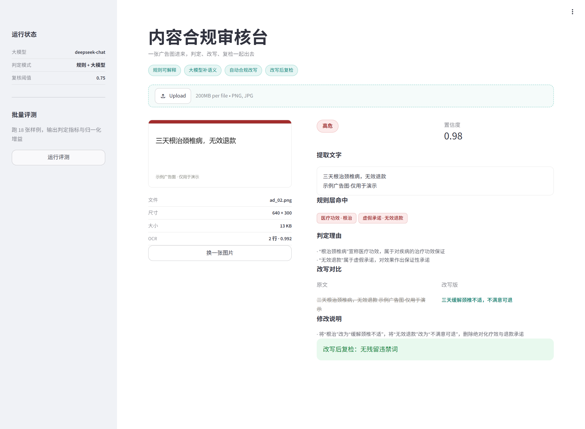

# 内容合规审核台（ai-content-guard）

> 上传一张广告 / 商品图 → OCR 提取图中文字 → 规则 + 大模型双层判定 → Agent 循环改写（改写 → 复检 → 有残留则重试）→ 输出合规稿与逐轮记录。

面向电商、内容平台的审核场景：不只判断「有没有问题」，还要给出合规改写，并且能量化效果。



# # 关键数字

| 指标 | 结果 | 口径 |
| --- | --- | --- |
| 真实商品图 F1 | 80.0%（精确 75.0% / 召回 85.7%） | 55 张人工标注，7 违规 / 48 正常 |
| 仅规则层的真实召回 | 0% | 同上，说明语义判定才是主力 |
| 改写零残留率 | 100%（10/10） | 合成违规样本，改写后回扫词表 |
| 单元测试 | 76 条，断网可跑 | 全部 mock 模型与 OCR |

# # 1. 链路

```text
图片 → RapidOCR 提取文字（含逐行置信度）
     → 文本归一化（全角转半角 / 去空白零宽 / 大小写归一）
     → 规则层（违禁词表 + 正则）
     → 大模型判定（风险等级 / 类别 / 置信度 / 理由）
     → 与规则层合并（取更严格一方，冲突标记转人工）

     ┌──────────── Agent 循环（最多 3 轮）────────────┐
     │  第 1 轮：扫词表 → 命中 → 改写（带上具体违规词）│
     │  第 2 轮：复检 → 仍有残留 → 带着残留词再改       │
     │  终止：零残留通过 / 达到上限转人工 / 改写失败    │
     └────────────────────────────────────────────────┘

     → 每轮落 RoundLog，形成可观测 trace
     → Streamlit 左右对比 + HTTP API 两种出口
```

# # 2. 快速开始

```bash
python -m venv .venv && .venv/Scripts/activate     # Windows
pip install -r requirements.txt

cp .env.example .env            # 填入有效的 DEEPSEEK_API_KEY
python tools/make_samples.py    # 生成 18 张样例图 + labels.csv + noise_cases.json

python -m src.evaluate --no-llm         # 只跑规则层，快且免费
python -m src.evaluate --with-rewrite   # 规则 + LLM + 改写效果评测

streamlit run app.py                    # 网页界面
uvicorn src.api:app --port 8000         # HTTP 接口，文档见 http://127.0.0.1:8000/docs

pip install -r requirements-dev.txt
pytest                                  # 76 条单元测试，断网可跑，不调 API
```

> 必须用 `streamlit run` 启动。直接 `python app.py` 会被启动守卫拦下并给出提示——
> Streamlit 在 bare mode 下 `st.stop()` 不生效，会抛出与真实原因无关的 `NoneType` 报错。

首页有三张样图可一键试用，分别对应「规则命中 / 应当放过 / 规则漏检」三种情况。

# # 3. 接口示例

```bash
curl -X POST http://127.0.0.1:8000/review -F "file=@data/samples/ad_02.png"
```

返回结构含判定结果、逐条命中、改写稿、残留，以及 `agent_rounds`（每轮命中 / 残留数量）——调用方能看到「第几轮才改干净」，而不是只拿到一个最终答案。

# # 4. Agent 层：为什么不直接用 AgentExecutor

改写流程是确定性的：扫词表 → 有命中就改 → 复检 → 有残留再改。工具选择没有歧义，交给模型自主决策只会带来不可控（不知道它会调什么）和不可测（无法断言每轮做了什么）。

所以这里只借用 LangChain 的 `@tool` 抽象声明「有哪些工具可用」（`scan_violations`、`rewrite_violations`），控制流和终止条件自己写：

| 终止条件 | 行为 |
| --- | --- |
| 零残留 | 通过，返回最终文案 |
| 达到最大轮次（默认 3） | 转人工，记录残留 |
| 改写未执行（无 Key / 网络失败） | 立即转人工，不空转重试 |
| 超出时间预算 | 不再开新一轮，直接转人工 |

最后一条是为了服务化：单次调用 + 判定，最坏能拖到 80s 以上，而多数网关 60s 就断开连接了。预算从 OCR 开始计时，每轮开始前检查剩余时间，不足半次调用就不开。

这样既能回答「你为什么用 LangChain」，也能回答「你为什么不全靠 Agent」。

# # 5. 测试

```bash
pytest          # 76 passed
```

| 文件 | 用例 | 覆盖内容 |
| --- | --- | --- |
| `test_rules.py` | 31 | 归一化（换行 / 空格 / 全角 / 零宽）、大小写不敏感、手机号数字边界、风险分级 |
| `test_agent.py` | 15 | 一轮收敛、两轮才收敛、跑满上限转人工、改写失败立即停、规则漏检强制改写 |
| `test_judge.py` | 12 | 规则与模型冲突取严、冲突时置信度压制、失败降级留痕、字段容错 |
| `test_pipeline.py` | 9 | OCR 无文字不判合规、无 Key 时不报残留、复核原因、合规不触发改写 |
| `test_jsonutil.py` | 9 | 围栏、前后多余文字、中文引号、未闭合括号 |

全部用 mock 顶掉模型调用与 OCR，不打网络、不需要 Key，任何机器上都能跑。

多轮改写在真实评测集里从未被触发（18 张全部第 1 轮收敛），所以 `test_agent.py` 用脚本化 mock 专门覆盖了「第 1 轮残留 → 第 2 轮清零」这条路径。

# # 6. 评测结果

# # # 6.1 判定指标（主评测集 18 张：违规 10 / 正常 8）

| 模式 | 准确率 | 精确率 | 召回率 | F1 |
| --- | --- | --- | --- | --- |
| 仅规则 | 77.8% | 100% | 60.0% | 75.0% |
| 规则 + 大模型 | 100% | 100% | 100% | 100% |

规则层的 4 条漏检全部集中在 `hard_` 样本：「三天见效，不吃药也能好」「老中医推荐，腰不疼了」「无效包退」「全网底价」——都是词表命中不了的语义变体。接上 LLM 后这 4 条全部补回，召回 60% → 100%，且没有引入新的误报。

> 18 张样本是合成图，标签由脚本构造，这组 100% 只能证明链路与策略有效，不代表真实分布下的效果。真实数据见 6.4：精确率 75%、召回率 85.7%。

# # # 6.2 文本归一化的增量价值（9 条脏文本，开 / 关对比）

| 指标 | 不做归一化 | 归一化后 |
| --- | --- | --- |
| 违规文本召回（6 条） | 50% | 100% |
| 正常文本误报（3 条） | 0/3 | 0/3（未引入新误报） |

这组用例是直接喂文本的，不走 OCR——RapidOCR 自己就会把全角符号和字间空格抹平，用图片造噪声根本测不出来。覆盖的噪声形态：

- 跨行断词：`无效退\n款` → 归一化前漏检
- 字间空格：`无效 退款` → 归一化前漏检
- 全角符号：`１００％` → 归一化前漏检
- 大小写变体：`加v` / `Vx` → 归一化前漏检（词表只收录了 `加V`）

# # # 6.3 改写复检指标

`python -m src.evaluate --with-rewrite` 会输出：改写执行率、零残留率、平均残留词数、逐条修改说明。

| 指标 | 数值 |
| --- | --- |
| 违规样本 | 10 条 |
| 改写执行率 | 100% |
| 零残留率 | 100%（10/10 改写后词表零命中） |
| 平均残留违禁词 | 0.00 个/条 |

典型改写：`三天根治颈椎病，无效退款` → `三天缓解颈椎不适，不满意可退`；`加微信 abc123，一手货源` → `私信咨询，一手货源`。

需要说明的是，改写后复检用的是规则词表，它能证明「原有的违禁词被清掉了」，但证明不了「新文案语义完全合规」——后者仍需人工复核，这也是产品把改写结果定位为「建议稿」而非「终稿」的原因。

报告见 `reports/eval_report.md`，逐条列出真实标签、预测、风险级、置信度、OCR 质量与备注。

# # # 6.4 真实商品图（55 张，人工标注）

上面三节的样本都是脚本合成的。这一节是真实数据：55 张电商截图，覆盖服装、食品、化妆品、医疗器械四类，人工标注 7 条违规、48 条正常。

| 模式 | 精确率 | 召回率 | F1 | 混淆矩阵 |
| --- | --- | --- | --- | --- |
| 仅规则 | — | 0% | — | TP=0 FP=0 FN=7 TN=48 |
| 规则 + 大模型 | 75.0% | 85.7% | 80.0% | TP=6 FP=2 FN=1 TN=46 |

这是全项目最重要的一组数据。

仅规则层时，7 条真违规一条都没抓到。不是代码 bug，而是真实违规长这样：

- 「缓解干眼症症状」——词表没有「干眼症」
- 「医用同款」「药房同款」——词表只有「国家级」
- 「家庭氧疗」「孕期补氧」——词表没有「氧疗」
- 「28 天细腻透亮」「内源焕活」——词表没有时效承诺类
- 「养胃红茶」——词表没有「养胃」

37 个词覆盖不了真实违规的长尾形态。接入大模型后召回 85.7%——语义判定才是主力，规则层是低成本兜底。

剩余 2 条误报的归因：

| 图 | 原因 | 能否修 |
| --- | --- | --- |
| `real_050` | 模型把「激光治疗术后」判为宣称疗效（规则层已通过上下文排除，模型未排除） | 需改提示词，有压召回的风险 |
| `real_054` | OCR 把「一赔十」认成「一陪十」，模型据此判绝对化承诺 | 属 OCR 缺陷，改不了 |

已知波动：上下文排除做完后跑了一次 FP=2；改之前连跑两次 FP 分别是 5 和 4。说明判定存在低频抖动，一次结果不能当定论。样本只有 55 张、7 条违规，1 条误报就是 10 个百分点——这组数字只有方向性，不要当精确值引用。

```bash
python tools/eval_real.py            # 仅规则层，不花额度
python tools/eval_real.py --llm      # 规则 + 大模型
python tools/eval_real.py --detail   # 打印逐张判定
```

> 图片不入库（第三方版权素材，已在 `.gitignore` 排除）；标注与 OCR 全文在 `data/real/`。

# # 7. 设计取舍

1. 规则 + LLM 双层，而不是纯 LLM：规则可解释、零成本；LLM 补语义。两层结果都输出，不做黑盒。
2. 冲突取更严格一方：规则层是「根治」这种确定性命中，LLM 偶尔会讲道理判成 low。若让 LLM 直接覆盖规则，等于让不确定的一方推翻确定的一方。冲突时风险取高值、置信度压到阈值以下、标记转人工。
3. OCR 失败 ≠ 合规：早期版本把「没识别到文字」判成 low + 置信度 1.0，界面走绿色通过——这是审核系统里最危险的错误。现在单独返回 `unknown`，强制转人工，并在界面用醒目样式区分。
4. 文本归一化前置：OCR 的换行、空格、全角字符会让子串匹配静默失效。归一化把这类漏检清零，且不引入新误报（有对照样本守着）。
5. 改写后复检：改完再扫一遍词表，量化残留。同时区分「改写未执行」和「改写不干净」——两者的提示语完全不同。
6. 置信度分流：低于 0.75 标人工复核；仅规则层判定、OCR 质量偏低、两层冲突，也都会进入复核队列。
7. 失败可见：LLM 调用失败记 `status=llm_failed` + 具体错误 + 日志告警，不静默降级。评测报告里会明确写「本次 LLM 全部失败，等同仅规则模式」。

# # 8. 已知限制

关于评测可信度（最重要的一组）：

- 合成集的 100% 不代表真实效果。18 张白底黑字、排版干净、标签由脚本构造，只能证明链路正确。真实数据见 6.4：精确率 75%、召回率 85.7%。
- 真实集只有 55 张、7 条违规，且是单人标注。样本量太小，1 条误报就是 10 个百分点的波动；「医用同款」这类表述是否违规还存在类目差异（医疗器械 vs 服装），目前没有类目区分，也没有第二人复核。
- 规则层在真实文案上有明显误报：10 条合法电商文案实测，6 条被误报——「最好的售后」命中「最好」、「绝对值这个价」命中「绝对」、「减肥期间也可以吃」命中「减肥」、「排毒养颜茶」命中「排毒」、「国家级非遗工艺」命中「国家级」。合成集上的 100% 精确率只在那批构造样本上成立。用例存于 `data/eval/fp_cases.json`，`python tools/check_fp.py` 可复现。

能力边界：

- 只审「图里的文字」，不审画面（血腥 / 暴露 / 侵权）。视觉理解是多模态的下一步。
- 改写后的语义合规性没有被验证。复检只扫词表，能证明原违禁词被清掉，证明不了新文案没有新的暗示性违规。
- 判定与改写都依赖单次 LLM 调用，没有重试与多模型投票；模型抖动会直接影响结果。
- 无并发、无性能压测，单机 demo 级。

# # 9. 目录

​```text
ai-content-guard/
├── app.py                Streamlit 界面
├── pytest.ini
├── requirements.txt
├── requirements-dev.txt
├── src/
│   ├── config.py         常量：词表路径、轮次上限、时间预算
│   ├── ocr.py            RapidOCR 封装（单例）
│   ├── rules.py          归一化 + 词表 + 正则 + 上下文排除
│   ├── judge.py          大模型判定 + 两层合并（取严）
│   ├── pipeline.py       主链路 detect()：OCR → 判定
│   ├── agent.py          Agent 循环改写 + RoundLog
│   ├── rewrite.py        DeepSeek 改写调用
│   ├── jsonutil.py       LLM 返回 JSON 的容错解析
│   ├── evaluate.py       评测脚本（--no-llm / --with-rewrite）
│   ├── logutil.py        日志
│   └── api.py            FastAPI /review 接口
├── tools/
│   ├── make_samples.py   生成 18 张样例图 + 标注
│   ├── eval_real.py      55 张真实图评测
│   └── check_fp.py       误报用例复现
├── data/
│   ├── lexicon.json      违禁词表（改了立即生效）
│   ├── samples/          合成样例图
│   ├── real/             55 张真实图 + 人工标注
│   └── eval/             误报 / 噪声用例
├── tests/                76 条单测（断网可跑）
├── reports/              评测报告输出
├── docs/                 补充文档
└── assets/               README 截图
​```


 ##10. 未来方向

1. 把真实集从 55 张扩到 150 张以上（当前 7 条违规，1 条就占 14 个百分点，召回率算不稳），并做第二人交叉标注。真实图引入已完成，卡在样本量和标注可靠性上。
2. 极限词从「子串匹配」升级为「上下文规则 + LLM 复核」，压掉「最好的售后」这类误报。这一项在产品侧最实，但没有真实分布之前，10 条文案 60% 的误报率只是弱证据，收益要等第 1 步做完才能量化。
3. 改写结果加二次语义复检（把改写稿再走一遍判定），把「词表零残留」升级成「语义零风险」。

 ##11. 环境

| 项 | 版本 |
| --- | --- |
| Python | 3.12 |
| OCR | rapidocr-onnxruntime 1.4.4 + onnxruntime 1.31.0（本地，不联网） |
| 判定 / 改写 | DeepSeek `deepseek-chat`（OpenAI 兼容接口） |
| 接口 | fastapi 0.162.0 + uvicorn 0.54.0 |
| 界面 | streamlit 1.64.0 |
| 校验 | pydantic 2.14.1 |
